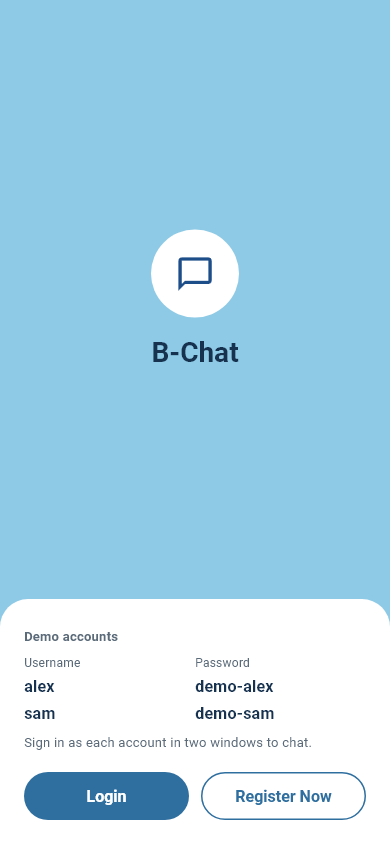
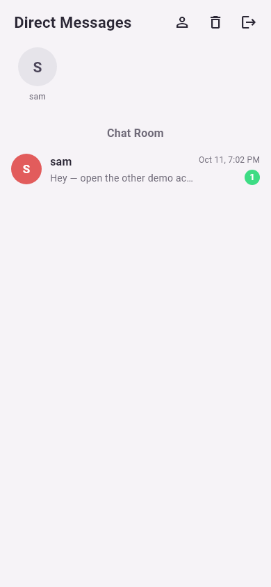
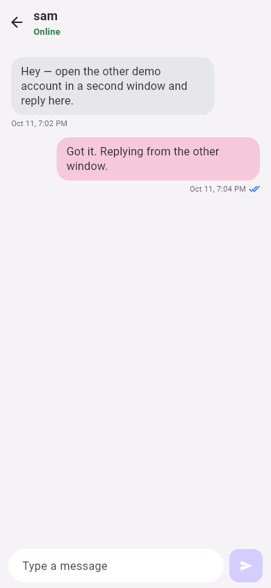

# B-Chat

A realtime chat app. Sign in, open a conversation, and messages show up on the other side over a websocket, along with online status.

Live demo: [https://b-chat-psi.vercel.app](https://b-chat-psi.vercel.app)

The welcome screen lists two accounts that already exist on the demo server. Sign in as each one in a separate window:

| Username | Password   |
| -------- | ---------- |
| alex     | demo-alex  |
| sam      | demo-sam   |

<p>
  
  
  
</p>

## Run it

Start the [server](../server/README.md) first. This app talks to `http://localhost:8000` unless you pass another address. The Android emulator uses `http://10.0.2.2:8000`.

```bash
flutter pub get
flutter run
```

Web:

```bash
flutter run -d chrome
```

A release web build bakes the API address in at compile time:

```bash
flutter build web --dart-define=API_BASE_URL=https://your-api.example.com
```

The site is the `build/web` folder. Deploy that folder on its own. The server's `ALLOWED_ORIGINS` has to be the exact site origin, such as `https://b-chat-psi.vercel.app`.

## Tests

```bash
flutter test
```
